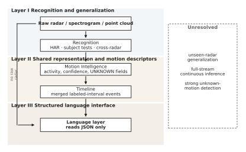
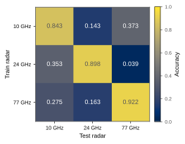
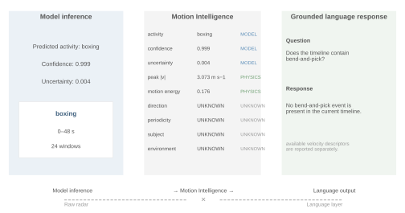

# RadarMind

Toward Generalizable Human Motion Understanding Across Radar Domains

RadarMind is a research framework for radar-based human activity recognition, generalization analysis, continuous labeled-interval inference, open-set rejection, structured Motion Intelligence, and grounded language interaction.

## Overview

Conventional radar HAR can perform well within a known sensing domain, but recognition reliability can degrade when the subject, radar hardware, temporal context, or activity inventory changes. RadarMind studies this transition from isolated recognition toward generalizable motion understanding.

The working path is radar representation → recognition and diagnostic probes → Motion Intelligence / timeline → language layer. The language layer does not receive raw radar.

## Framework



Fig. 1 is generated from `scripts/paper_figures/rebuild.py` using `results/final_delivery/metric_snapshot_full.json` where a figure needs numbers. The schematic itself is not an accuracy claim.

## Key Results

Values are copied from `docs/generated/key_results.md`, which is generated from `results/final_delivery/metric_snapshot_full.json`. Do not edit the table by hand.

| Result | Value | Snapshot key |
|---|---|---|
| mRI subject-independent accuracy | 0.478 | `MRI_SI_ACC` |
| mRI subject-independent macro-F1 | 0.420 | `MRI_SI_F1` |
| RadHAR official XYZV accuracy | 0.949 | `RADHAR_XYZV_ACC` |
| RadHAR official XYZV macro-F1 | 0.949 | `RADHAR_XYZV_F1` |
| CI4R 10 GHz within (R0) | 0.843 | `R0_10_WITHIN` |
| CI4R 24 GHz within (R0) | 0.898 | `R0_24_WITHIN` |
| CI4R 77 GHz within (R0) | 0.922 | `R0_77_WITHIN` |
| CI4R 24→77 source-only (R0) | 0.039 | `R0_24_TO_77` |
| M1 known-radar activity accuracy | 0.932 | `M1_ACC` |
| M1 same-action retrieval | 0.935 | `M1_RET` |
| M1 3-radar Radar-ID | 1.000 | `M1_RID` |
| R2-D 3-radar Radar-ID | 0.993 | `RID_R2D_3CLASS` |
| R2-V 24/77 Radar-ID | 0.939 | `RID_R2V_2477` |
| Continuous frame Acc / F1 | 0.489 / 0.416 | `CONT_FRAME_ACC`, `CONT_FRAME_F1` |
| Continuous window Acc / F1 | 0.494 / 0.419 | `CONT_WIN_ACC`, `CONT_WIN_F1` |
| Continuous segment F1 | 0.152 | `CONT_SEG_F1` |
| Continuous boundary error (s) | 20.6 | `CONT_BND_SEC` |
| Prototype LOAO AUROC | 0.628 ± 0.125 | `PROTO_AUROC`, `PROTO_AUROC_STD` |

Cross-radar source-only matrix (R0):



## Scientific Scope

| Included | Not included |
|---|---|
| Closed-set HAR on CI4R, mRI, RadHAR | Universal sensor-invariant representation |
| mRI subject-independent evaluation | CI4R subject-independent evaluation |
| Source-only 10/24/77 transfer, CORAL UDA, LORO | Solved unseen-radar HAR |
| Shared representation M0–M3 and Radar-ID probes | Open-world / open-vocabulary recognition |
| Physical diagnostics (R0–R2, U1/U2, D(v\|q), TEST oracle) | Deployable radar translator |
| Labeled-interval continuous replay | Full-stream continuous sensing |
| 13-fold LOAO open-set rejection | Background-class invention |
| Motion Intelligence + optional language layer | LLM as an evidence source |

## Repository Structure

This is the current tree. Scientific packages were not relocated for packaging.

```
radarmind/                 runtime package (adapters, engine, MI, LLM, Streamlit)
scripts/                   phase training, evaluation, paper rebuilders
src/paper/                 figure style
data_splits/               fixed splits
results/                   frozen metrics (weights and caches stay local)
figures/main/              manuscript SVG figures
docs/                      datasets, experiments, limitations
tests/                     manuscript metric contract
run_radarmind.py           research application
scripts/release/           frozen-result verification
```

`data_splits/ci4r_subject_independent.csv` is a legacy filename for a prefix-group-disjoint split. See `docs/KNOWN_NAMING_ISSUES.md`.

## Installation

Runtime used for the v0.2 freeze: Python 3.11, conda env `airhar`, PyTorch 2.7.1 with a CUDA 12.8 wheel on the original GPU. Install a torch build that matches the local machine.

```
conda activate airhar
python -m pip install torch torchvision torchaudio --index-url https://download.pytorch.org/whl/cu128
python -m pip install -r requirements.txt
python -m pip install -r requirements-app.txt
```

CPU-only torch is enough for snapshot checks and table/figure rebuild. Training needs GPU.

Copy `.env.example` to `.env` only if the language layer should call a provider. The rest of the repository runs without a key.

## Datasets

CI4R (10 / 24 / 77 GHz), mRI, and RadHAR. Raw archives are not in this repository. Loaders, splits, and frozen metrics are. See `docs/DATASETS.md`.

## Quick Start

```
python scripts/release/quick_verify.py
python run_radarmind.py --offline-demo
```

The application is http://localhost:8502. Sample inference pages need local caches and checkpoints under `results/`. Metric pages need the frozen JSON/CSV files.

## Closed-Set HAR

ResNet18 spectrogram (CI4R), PointNet-GRU (mRI / RadHAR), Voxel CNN-GRU (RadHAR). Training scripts: `scripts/ci4r/phase1a_train.py`, `scripts/pointcloud/phase1b_train.py`, `scripts/pointcloud/train_voxel.py`.

## Subject-Independent Evaluation

Reported only on mRI official subject IDs (`data_splits/mri_subject_independent.csv`; test subjects 3, 10, 20). CI4R filename prefixes are acquisition groups, not verified subject identities.

## Cross-Radar Evaluation

Paired 327 agreed triples, 7 shared classes, 229 / 49 / 49 acquisition split. Source-only 3×3 matrix from `results/phase2_cross_radar/runs/*/metrics.json`. Entry: `run_cross_radar_experiments.py`.

## Shared Representation Learning

M0 CE; M1 CE+InfoNCE; M2 physics-informed augmentation; M3 CE+InfoNCE+GRL. Known-radar joint training is not leave-one-radar-out. Entry: `run_shared_motion_experiments.py`, `scripts/phase7/train_m3.py`.

## Physical Radar-Domain Diagnostics

R0 official PNG, R1 crop/normalize, R2-D numerical Doppler, R2-V velocity alignment, U1/U2, D(v|q), low-rank 2D Δ, TEST oracle. R² is a reconstruction metric. The TEST oracle is a diagnostic upper bound, not a deployable translator.

## Continuous Inference

Labeled-interval replay on mRI (`scripts/continuous/run_all.py`, `run_continuous_demo.py`). Not full-stream continuous sensing.

## Open-Set Rejection

13-fold leave-one-action-out on mRI (`run_open_set_experiments.py`). Held-out actions stay out of training, validation, and threshold fitting. Rejected output is `UNKNOWN`. This is not open-world or open-vocabulary recognition.

## Motion Intelligence

Typed JSON with provenance `MODEL` / `PHYSICS_DERIVED` / `METADATA` / `UNKNOWN`. `UNKNOWN` is not zero and is not guessed. See `docs/MOTION_INTELLIGENCE.md`.

## Language Interaction

Structured prompt over Motion Intelligence and timeline. Entry: `python run_radarmind.py` with optional `.env`. Template fallback when offline.



## Reproducing the Paper

**Quick verification** (no training):

```
python scripts/release/quick_verify.py
```

**Frozen-result reproduction** (tables, figures, registry):

```
python scripts/release/reproduce_from_frozen.py
```

**Full training** is a separate, expensive path. Use the existing phase scripts in `docs/EXPERIMENTS.md`. Do not overwrite frozen `metrics.json` files.

**Research application:** `python run_radarmind.py` (see `docs/RESEARCH_APP.md`).

## Research Application

`python run_radarmind.py` starts `radarmind/app/streamlit_app.py`. There is no separate Studio product in this tree.

## Results

Canonical snapshot: `results/final_delivery/metric_snapshot_full.json`  
Registry: `scripts/paper_v2/registry.py`  
Freeze ledger: `results/frozen_2026_08/`  
Tables: `results/paper_package_v2/tables/`

## Important Scientific Boundaries

- Robust unseen-radar generalization remains unresolved.
- RadarMind does not claim a universal sensor-invariant representation.
- Subject-independent evaluation is reported only using verified subject identities.
- CI4R filename prefixes are acquisition groups rather than verified subject identities.
- Continuous analysis is labeled-interval replay, not full-stream continuous sensing.
- LOAO evaluates open-set rejection, not open-world or open-vocabulary recognition.
- Motion-conditioned R² values are reconstruction metrics rather than HAR accuracy.
- TEST oracle projection is a diagnostic upper bound, not a deployable radar translator.
- The language model receives structured Motion Intelligence and timeline records rather than raw radar measurements.

Further discussion: `docs/LIMITATIONS.md`.

## Citation

If you use RadarMind, please cite the accompanying manuscript:

Luo, L., & Sun, X. *RadarMind: Toward Generalizable Human Motion Understanding Across Radar Domains*. Manuscript.

Journal, volume, pages, and DOI are not assigned. See `CITATION.cff`.

## Contributors

RadarMind was developed with contributions from:

- Li Luo
- Xuehong Sun
- [@ec12312312333](https://github.com/ec12312312333)

`ec12312312333` is a project contributor. Paper authorship is listed in `CITATION.cff` and the manuscript only.

## License

RadarMind is released under the MIT License. See [`LICENSE`](LICENSE) for details.
